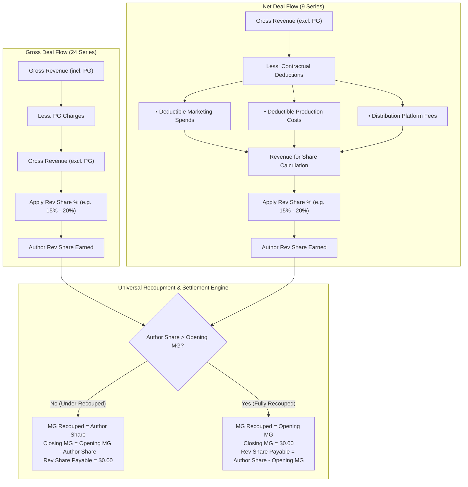

# Pocket FM — Confidential Partner Portal & Internal Management Hub

[](https://pocketfm-statements.vercel.app)
[](https://pocketfm-statements.vercel.app/internal_hub)
[](#-statements-directory--catalog)
[](#-royalty--recoupment-accounting-mathematics)
[](#-single-page-print--pdf-export-engine)

Welcome to the official documentation for the **Pocket FM Confidential Partner Portal & Internal Management Hub** website. This platform provides an enterprise-grade, confidential royalty accounting, statement generation, and partner distribution ecosystem for Pocket FM authors, rights holders, and executive licensing managers.

---

## 📑 Table of Contents

1. [Executive Summary & Architecture](#-executive-summary--architecture)
2. [Live Production URLs](#-live-production-urls)
3. [Website Structure & Page Guide](#-website-structure--page-guide)
   - [1. Confidential Partner Portal Gateway (`index.html`)](#1-confidential-partner-portal-gateway-indexhtml)
   - [2. Internal Statement Management Hub (`internal_hub.html`)](#2-internal-statement-management-hub-internal_hubhtml)
   - [3. Dynamic Statement Viewer (`statement_viewer.html`)](#3-dynamic-statement-viewer-statement_viewerhtml)
   - [4. Pre-Rendered Standalone Statements (`statements/*.html`)](#4-pre-rendered-standalone-statements-statementshtml)
4. [Royalty & Recoupment Accounting Mathematics](#-royalty--recoupment-accounting-mathematics)
   - [Gross Deal Mechanics](#gross-deal-mechanics-24-series)
   - [Net Deal Mechanics](#net-deal-mechanics-9-series)
5. [UI Features & Component Guide](#-ui-features--component-guide)
   - [Modern Classic Custom Dropdowns](#modern-classic-custom-dropdowns)
   - [Hub Navigation Tabs](#hub-navigation-tabs)
   - [Interactive Deal Ledgers](#interactive-deal-ledgers)
   - [Add New Revenue Statement Modal](#add-new-revenue-statement-modal)
6. [Single-Page Print & PDF Export Engine](#-single-page-print--pdf-export-engine)
7. [Data Ingestion & Automated Generator Pipeline](#-data-ingestion--automated-generator-pipeline)
8. [Deployment & Hosting Infrastructure](#-deployment--hosting-infrastructure)
9. [Operations & Maintenance Playbook](#-operations--maintenance-playbook)
10. [Appendix: Legacy Scraping & Automation Suite](#-appendix-legacy-scraping--automation-suite)

---

## 🏛 Executive Summary & Architecture

The Pocket FM Revenue Statements web ecosystem bridges the gap between raw audited financial spreadsheets and polished, confidential, author-facing royalty statements. It operates with two interconnected layers:

```
┌──────────────────────────────────────────────────────────────────────────┐
│                   POCKET FM REVENUE STATEMENTS PLATFORM                   │
└──────────────────────────────────────────────────────────────────────────┘
                                      │
         ┌────────────────────────────┴───────────────────────────┐
         ▼                                                        ▼
┌─────────────────────────────────┐              ┌─────────────────────────────────┐
│     EXTERNAL PARTNER LAYER      │              │      INTERNAL LICENSING HUB     │
├─────────────────────────────────┤              ├─────────────────────────────────┤
│ • Branded Partner Portal Entry  │              │ • 33 Series Interactive Grid    │
│ • Secure, Slug-Hashed Statements│              │ • Master Revenue Summary Matrix │
│ • Dynamic Query Param Viewer    │              │ • Gross & Net Financial Ledgers │
│ • 1-Page Exact Print / PDF      │              │ • Add New Statement Generator   │
└─────────────────────────────────┘              └─────────────────────────────────┘
         ▲                                                        ▲
         │                                                        │
         └────────────────────────────┬───────────────────────────┘
                                      │
                       ┌──────────────┴──────────────┐
                       │  PYTHON AUTOMATION BACKEND  │
                       ├─────────────────────────────┤
                       │ • Finance XLSX Ingestion    │
                       │ • Recoupment Calculations   │
                       │ • HTML Template Compilation │
                       │ • Live Vercel Deployments   │
                       └─────────────────────────────┘
```

### Key Technical Highlights
- **Zero-Dependency Frontend**: Pure HTML5, modern vanilla CSS3, and ES6+ JavaScript. No bloated frameworks or hydration delays; loads instantaneously worldwide over the Vercel Edge Network.
- **Audited Financial Precision**: Exact mathematical alignment with Pocket FM Finance sheets for Gross Deals and Net Deals, handling minimum guarantee (MG) recoupment, payment gateway deductions, and multi-period carryovers.
- **Uniform Executive Typography & Borders**: All statement tables feature crisp, uniform `1px solid #000000` borders, `#f0f0f0` executive header backgrounds, and direct exposed table layouts without distracting card borders.
- **Pixel-Perfect 1-Page PDF Engine**: Engineered with strict `@media print` rules, margin bounding, and `-webkit-print-color-adjust: exact` to produce a single-page PDF document when printing.

---

## 🌐 Live Production URLs

The web application is deployed to production on Vercel:

| Endpoint | Target File | Purpose | Access Audience |
| :--- | :--- | :--- | :--- |
| **`https://pocketfm-statements.vercel.app/`** | [index.html](file:///e:/Internship/PocketFM/docs/unified_statements/index.html) | Public confidential gate & partner help info | Authors, Public |
| **`https://pocketfm-statements.vercel.app/internal_hub`** | [internal_hub.html](file:///e:/Internship/PocketFM/docs/unified_statements/internal_hub.html) | Internal management hub, ledgers & creator tool | Licensing Team, Execs |
| **`https://pocketfm-statements.vercel.app/statement_viewer`** | [statement_viewer.html](file:///e:/Internship/PocketFM/docs/unified_statements/statement_viewer.html) | Dynamic single-statement renderer & PDF exporter | Authors, Licensing Team |
| **`https://pocketfm-statements.vercel.app/statements/<slug>.html`** | [statements/](file:///e:/Internship/PocketFM/docs/unified_statements/statements) | 33 standalone pre-rendered official statements | Contracted Partners |

---

## 💻 Website Structure & Page Guide

The website root is located at [`docs/unified_statements/`](file:///e:/Internship/PocketFM/docs/unified_statements):

```text
docs/unified_statements/
├── index.html                    # Confidential Partner Portal Gateway
├── internal_hub.html             # Internal Management Hub & Financial Ledgers
├── statement_viewer.html         # Dynamic Query-Driven Statement Renderer
├── vercel.json                   # Vercel Clean URLs Configuration
├── favicon.svg                   # Vector Brand Favicon
├── favicon.png                   # 32x32 Raster Favicon
├── favicon-128.png               # 128x128 Apple Touch Icon
├── Pocket_FM_Revenue_Statement_Template_Gross.docx # Gross Deal Modern Word Template (.docx)
├── Pocket_FM_Revenue_Statement_Template_Gross.doc  # Gross Deal Legacy Word Template (.doc)
├── Pocket_FM_Revenue_Statement_Template_Net.docx   # Net Deal Modern Word Template (.docx)
├── Pocket_FM_Revenue_Statement_Template_Net.doc    # Net Deal Legacy Word Template (.doc)
├── Pocket_FM_Revenue_Statement_Template.doc        # Legacy Reference Template
└── statements/                   # 33 Pre-Rendered Standalone HTML Statements
    ├── a-shade-of-vampire-series-2908daf8.html
    ├── after-darkness-falls-d4483a6c.html
    ├── billionaire-bear-brotherhood-dcc2b862.html
    ├── blake-larsen-3c6159c2.html
    ├── blood-vice-504adcc0.html
    ├── blood-vice-q2-amj-995fdcf9.html
    ├── carolina-tales-cfd9b2f8.html
    ├── death-before-dragon-series-2d51754e.html
    ├── detective-emilia-cruz-8051f011.html
    ├── fae-chronicles-series-11f9a625.html
    ├── forever-series-f1fcf138.html
    ├── house-of-cards-b98a39e8.html
    ├── hunting-the-hunters-3fbb1c58.html
    ├── legacy-series-76d7d7f7.html
    ├── love-on-the-line-series-69c76251.html
    ├── modern-prophets-trilogy-47d3c0aa.html
    ├── monster-brotherhood-63f451f2.html
    ├── monsters-within-series-7521ca9f.html
    ├── shadow-beast-shifters-86f343a4.html
    ├── shifter-royals-d51a66e4.html
    ├── silent-truth-series-2908daf8.html
    ├── slate-rock-valley-826359bc.html
    ├── sons-of-the-survivalist-c93d9396.html
    ├── st-marins-cozy-mysteries-6a7e0a29.html
    ├── straight-into-hell-70bca5c7.html
    ├── the-complete-alaskan-series-97b77ce8.html
    ├── the-fallen-god-b1b75fa8.html
    ├── the-gods-series-44be25eb.html
    ├── the-inbetween-series-788bf7d5.html
    ├── the-lucas-brothers-552ecffb.html
    ├── the-scarred-alpha-52e69811.html
    ├── the-witches-of-cleopatra-hill-49e0c50d.html
    └── the-witches-of-cleopatra-hill-q2-amj-038c9bb2.html
```

---

### 1. Confidential Partner Portal Gateway (`index.html`)

- **Route**: `/` (or `/index.html`)
- **Visual Design**: Centered modern security card on `#f6f8fa` slate background, dark executive top header with official Pocket FM red accent (`#E51A4D`).
- **Core Message**: Informs authors and external visitors that all royalty statements are private and distributed through unique private hash links.
- **Support Advisory**: Provides direct email link to `us-licensing@pocketfm.com` for statement inquiries and contract verification.
- **Legal Footer**: Displays official business address: *Pocket Entertainment Services LLC • 13 West Main Street, PO BOX 953, Felton, DE 19943*.

---

### 2. Internal Statement Management Hub (`internal_hub.html`)

- **Route**: `/internal_hub`
- **Purpose**: The central command deck for the Pocket FM licensing and executive team to search, filter, inspect, and draft revenue statements.
- **Header Metrics**: Displays real-time catalog statistics (33 Total Shows, 24 Gross Deals, 9 Net Deals, Multi-Quarter Recoupment Tracking).

#### Hub Tabs
1. **`Statement Cards (33)`**:
   - Visual catalog cards divided into two primary reporting cycles:
     - **6-Month Combined Series (6 Shows)**: Q2 + Q3 combined reporting period (`April 1, 2026 – September 30, 2026`).
     - **3-Month Quarterly Series (27 Shows)**: Q3 quarterly reporting period (`July 1, 2026 – September 30, 2026`) and Q2 AMJ statements.
     - **Other / Custom Series**: Dynamically rendered container for any statements drafted by the user during the session.
   - Each card displays Series Title, Author, Deal Badge (`GROSS` in neutral slate, `NET` in green pill), reporting cycle, and a direct link to the corresponding statement.
2. **`Master Revenue Summary`**:
   - High-density horizontal financial spreadsheet containing all 33 production series.
   - Interactive Deal Filter: View **All Deals (33 Series)**, **Gross Deals (24 Series)**, or **Net Deals (9 Series)**.
   - Summarizes: Series Name, Author, Deal Type, Rev Share %, Period, Gross Rev excl. PG, Marketing Deductions, Production Deductions, Distribution Fees, Net Share Rev, Rev Share Earned, Opening MG, MG Recouped, Rev Share Payable, and Closing MG Available.
   - Features a calculated bottom summary row dynamically totaling all displayed rows.
3. **`Gross Deals Ledger (24)`**:
   - Focused ledger displaying all 24 Gross Deal contracts.
   - Includes an interactive **Show Selector dropdown** that dynamically renders a complete calculation ledger card for any selected Gross deal.
4. **`Net Deals Ledger (9)`**:
   - Focused ledger displaying all 9 Net Deal contracts with explicit deduction columns (Marketing Spends, Deductible Marketing, Production Costs, Deductible Production, Distribution Fees).
   - Includes an interactive **Show Selector dropdown** to view detailed Net calculation ledger cards.

#### Search & Filtering Engine
- **Live Search Input (`#searchInput`)**: Real-time matching against Series Name and Author name with instant card filtering.
- **Reporting Period Filter (`#filterPeriod`)**:
  - `All Periods`
  - `6-Month Combined`
  - `3-Month Quarterly`
  - `Annual`
  - `Other`
- **Deal Style Filter (`#filterStyle`)**:
  - `All Deals`
  - `Gross Deals`
  - `Net Deals`

#### "Add New Revenue Statement" Modal Dialog
- Triggered via the **`+ Add New Revenue Statement`** button in the hub header.
- Clean, wide dialog layout designed for rapid data entry without distracting icons.
- **Deal Style Toggle**: Switch between **Gross Deal** and **Net Deal**.
- **Big Table Input Mapping**:
  - **Gross Deal Fields**:
    - Gross Revenue (incl. PG)
    - PG Charges (deducted from gross)
    - Gross Revenue (excl. PG)
    - Revenue Share %
    - Opening MG Available
  - **Net Deal Fields**:
    - Gross Revenue (excl. PG)
    - Distribution Fees
    - Marketing Spends Reported
    - Marketing Deductions (contractually deductible amount)
    - Production Costs Reported
    - Deductible Production Costs
    - Revenue for Share Calculation
    - Revenue Share %
    - Opening MG Available
- **Live 4-Tile Recoupment Engine**: Recalculates dynamically on every keystroke:
  - `AUTHOR REV SHARE`: Contractual cut of revenue.
  - `MG RECOUPED`: Amount of Advance recoupable this period.
  - `CLOSING MG AVAILABLE`: Advance balance carrying forward to the next period.
  - `REV SHARE PAYABLE`: Cash payable to author after full MG recoupment.
- **Currency Support**: `USD ($)`, `EUR (€)`, `GBP (£)`, `INR (₹)`.
- **Period Selector**: `6-Month Combined`, `3-Month Quarterly`, `Annual Full Year`, and `Custom Period...` (reveals a custom date-range text input).
- **Client Persistence**: Saves new statements to browser `localStorage` (`pocketfm_internal_shows`), rendering a new card in the Hub with a direct link to `statement_viewer.html?id=...`.

---

### 3. Dynamic Statement Viewer (`statement_viewer.html`)

- **Route**: `/statement_viewer?id=<slug_or_id>`
- **Purpose**: Dynamic single-statement renderer capable of loading pre-compiled production statements, URL query parameters, or locally drafted statements from `localStorage`.
- **Layout & Structure**:
  - **Executive Header**: Pocket FM logo with red accent, branded title, and corporate subtitle.
  - **Audience Metrics Row**: 2-tile KPI block showing **Total Listeners** and **Total Plays** with light-gray `#f0f0f0` labels and crisp black borders.
  - **Metadata Info Table**: 2-column key-value table showing Series Name, Author, and Reporting Period.
  - **Recoupment Summary Tiles**: 3 prominent metric tiles:
    - `MG AVAILABLE`: Opening unrecouped Minimum Guarantee.
    - `MG RECOUPED`: Portion of MG satisfied by this period's earnings.
    - `REVENUE SHARE PAYABLE`: Net cash disbursement due to author.
  - **Exposed Big Table**: The definitive calculation matrix with **uniform 1px solid black borders** and **light-gray `#f0f0f0` headers**, completely free of outer card boxes or shadows. Shows line-by-line revenue, deductions, net shareable revenue, recoupment breakdown, and multi-period columns (e.g. Apr-Sep 2026 + Oct-Dec 2026 projections).
  - **Terms & Notes**: Legal breakdown of payment terms (Net 45 / Net 60), tax withholding, and audit rights.
  - **Signatory Block & Legal Footer**: Pocket FM executive signature and company registered entity info.
  - **Floating Action Button**: Fixed-position **"Download Statement (PDF)"** pill in official brand red (`#E51A4D`) that triggers `window.print()`.

---

### 4. Pre-Rendered Standalone Statements (`statements/*.html`)

- **Directory**: [`docs/unified_statements/statements/`](file:///e:/Internship/PocketFM/docs/unified_statements/statements)
- **File Count**: 33 self-contained, independent HTML documents.
- **Naming Scheme**: Deterministic URL slugs with truncated 8-character cryptographic hashes for privacy and anti-enumeration:
  - Example: `blood-vice-504adcc0.html`
  - Example: `st-marins-cozy-mysteries-6a7e0a29.html`
- **Self-Contained**: Each file has embedded CSS, table data, and print stylesheets. They require zero JavaScript execution to view and can be emailed as standalone attachments or downloaded directly.

---

## 🧮 Royalty & Recoupment Accounting Mathematics

Pocket FM operates two distinct contractual deal models for licensed IP:



### Gross Deal Mechanics (24 Series)
In a Gross Deal, author royalties are calculated directly on net gross sales without deductions for marketing or production.

1. **Gross Revenue (excl. PG)**:
   $$\text{Gross Excl. PG} = \text{Gross Revenue Incl. PG} - \text{Payment Gateway (PG) Charges}$$
2. **Author Revenue Share Earned**:
   $$\text{Author Rev Share} = \text{Gross Excl. PG} \times \text{Rev Share \%}$$
3. **Minimum Guarantee (MG) Recoupment**:
   $$\text{MG Recouped} = \min(\text{Author Rev Share}, \text{Opening MG Available})$$
4. **Closing MG Available (Carried Forward)**:
   $$\text{Closing MG Available} = \text{Opening MG Available} - \text{MG Recouped}$$
5. **Net Revenue Share Payable (Disbursement)**:
   $$\text{Rev Share Payable} = \max(0, \text{Author Rev Share} - \text{Opening MG Available})$$

### Net Deal Mechanics (9 Series)
In a Net Deal, certain contractually agreed operational expenses are deducted from gross revenues prior to calculating the author's share.

1. **Allowable Deductions**:
   - **Distribution Fees**: Third-party storefront or channel distribution costs.
   - **Marketing Deductions**: Pocket FM performance marketing spend allocated to the IP (subject to contractual caps, e.g. 15% or 20% of gross).
   - **Production Costs**: Audio adaptation, narration, sound engineering, and post-production costs (deducted in accordance with contractual terms).
2. **Revenue for Share Calculation (Net Base)**:
   $$\text{Net Base} = \text{Gross Excl. PG} - \text{Distribution Fees} - \text{Marketing Deductions} - \text{Deductible Production Costs}$$
3. **Author Revenue Share Earned**:
   $$\text{Author Rev Share} = \text{Net Base} \times \text{Rev Share \%}$$
4. **Recoupment & Settlement**:
   Recoupment follows the exact same minimum guarantee rules as Gross Deals:
   $$\text{MG Recouped} = \min(\text{Author Rev Share}, \text{Opening MG Available})$$
   $$\text{Closing MG Available} = \text{Opening MG Available} - \text{MG Recouped}$$
   $$\text{Rev Share Payable} = \max(0, \text{Author Rev Share} - \text{Opening MG Available})$$

---

## 🎨 UI Features & Component Guide

### Modern Classic Custom Dropdowns
All dropdown select elements across the Hub and Modals adhere to a modern classic aesthetic:
- **Clean Border & Geometry**: `1px solid #d0d7de` on crisp `#ffffff` background with subtle `4px` corner rounding.
- **Custom Embedded SVG Arrows**: Clean geometric downward chevrons encoded as SVG background images (`data:image/svg+xml,...`) positioned at `calc(100% - 10px)` to avoid native browser clunkiness.
- **Distinct Focus Ring**: Soft `#E51A4D` border highlight on focus with a delicate `0 0 0 3px rgba(229, 26, 77, 0.12)` glow.
- **Curated Option Sets**:
  - `filterStyle`: Strictly `All Deals`, `Gross Deals`, `Net Deals`.
  - `filterPeriod`: Strictly `All Periods`, `6-Month Combined`, `3-Month Quarterly`, `Annual`, `Other`.
  - `newCurr`: Multi-currency options `USD ($)`, `EUR (€)`, `GBP (£)`, `INR (₹)`.
  - `newCategory`: `6-Month Combined`, `3-Month Quarterly`, `Annual Full Year`, `Custom Period...`.

### Hub Navigation Tabs
The hub interface uses tab switching via simple class toggles (`active`) and display properties:
```javascript
function switchHubTab(tabName) {
  // Toggles active state on button and displays corresponding tab container:
  // 'statements' -> #tabContentCards
  // 'master'     -> #tabContentMaster
  // 'gross'      -> #tabContentGross
  // 'net'        -> #tabContentNet
}
```

### Add New Revenue Statement Modal
Accessible via `#addModal`, the creation dialog features:
- **Responsive 2-Column Grid**: Key metadata fields (Title, Author, Currency, Period, Deal Type) laid out in pairs.
- **Conditional Field Rendering**: Selecting **Gross Deal** reveals PG and Gross fields; selecting **Net Deal** reveals Distribution, Marketing, and Production deduction inputs.
- **Auto-Calculated Output Grid**:
  ```
  ┌─────────────────────────┬─────────────────────────┐
  │    AUTHOR REV SHARE     │       MG RECOUPED       │
  │        $1,250.00        │        $1,250.00        │
  ├─────────────────────────┼─────────────────────────┤
  │   CLOSING MG AVAILABLE  │    REV SHARE PAYABLE    │
  │        $3,750.00        │          $0.00          │
  └─────────────────────────┴─────────────────────────┘
  ```
- **Instant Preview & Launch**: Clicking **Save Statement & View Card** immediately stores the show in browser memory, appends a card to `#otherGrid`, and offers a direct link to inspect the generated statement.

---

## 🖨 Single-Page Print & PDF Export Engine

The statement documents feature an advanced `@media print` style system engineered to guarantee that **every statement prints completely on exactly one page** without awkward second-page spillover:

```css
@page {
    size: auto;
    margin: 8mm 12mm 8mm 12mm;
}

@media print {
    /* 1. Force exact background color and border preservation */
    html, body {
        background-color: #ffffff !important;
        margin: 0 !important;
        padding: 0 !important;
        font-size: 11.5px !important;
        -webkit-print-color-adjust: exact !important;
        print-color-adjust: exact !important;
        color-adjust: exact !important;
    }
    * {
        -webkit-print-color-adjust: exact !important;
        print-color-adjust: exact !important;
        color-adjust: exact !important;
    }

    /* 2. Strip container wrappers, margins, and drop shadows */
    .document-container {
        box-shadow: none !important;
        margin: 0 !important;
        padding: 0 !important;
        max-width: 100% !important;
        width: 100% !important;
        border: none !important;
    }
    .content-padding { padding: 0 !important; }

    /* 3. Hide all non-printable interactive UI controls */
    .download-btn { display: none !important; }

    /* 4. Remove outer card boundaries so bill is directly exposed */
    .calculation-card {
        background-color: transparent !important;
        border: none !important;
        border-radius: 0 !important;
        padding: 0 !important;
        margin: 8px 0 10px 0 !important;
        box-shadow: none !important;
        page-break-inside: avoid !important;
        break-inside: avoid !important;
    }

    /* 5. Prevent pagination splits inside calculation tables */
    .calc-table-wrap, .calc-table, .info-table {
        page-break-inside: avoid !important;
        break-inside: avoid !important;
    }
}
```

### Table Border Uniformity
In both digital display and print:
- **Outer & Cell Borders**: Uniform `1px solid #000000` across all cells in both the Series Metadata table and the Big Calculation table.
- **Headers & Highlights**: `#f0f0f0` subtle gray fill on all header rows and sub-section summaries.
- **No Inner Boxes**: The calculation bill is directly exposed to the document surface without nesting borders.

---

## ⚙️ Data Ingestion & Automated Generator Pipeline

The statement catalog is built and compiled using Python 3:

```
Excel Data Sources
├── Rev Statement from Finance - JAS.xlsx (Audited Finance Data)
└── AMJ Self-Pub Revenue Payouts.xlsx (Q2 AMJ Specific Data)
                     │
                     ▼
  [ backend/generate_revenue_statements.py ]
                     │
         ┌───────────┴───────────┐
         ▼                       ▼
  33 HTML Files          internal_hub.html
  (in statements/)       (Embedded Master Ledger)
         │                       │
         └───────────┬───────────┘
                     ▼
          [ vercel deploy --prod ]
                     │
                     ▼
  https://pocketfm-statements.vercel.app
```

### Pipeline Script: `backend/generate_revenue_statements.py`
1. **`load_finance_jas_data()`**: Ingests rows from the audited `Rev Share Report` tab in `Rev Statement from Finance - JAS.xlsx`. Extracts gross revenue, marketing spend, deductions, MG paid, and listener analytics from `JAS All Shows Revenue Statement`.
2. **`load_amj_data()`**: Ingests verified Q2 AMJ statements for *The Witches of Cleopatra Hill* and *Blood Vice*.
3. **`generate_statement_html(show)`**: Injects audited financial values into the master HTML statement template, generating crisp tables, SVG badges, and print styles.
4. **`generate_internal_hub(shows)`**: Compiles `internal_hub.html` with:
   - Filterable cards for all 33 shows.
   - Comprehensive `Master Revenue Summary` horizontal matrix.
   - Separate `Gross Deals Ledger` and `Net Deals Ledger`.
5. **`deploy_to_vercel()`**: Invokes the Vercel CLI to deploy `docs/unified_statements` straight to the production URL.

### One-Click Batch Automation
A Windows batch runner is provided at [`backend/run_revenue_generator.bat`](file:///e:/Internship/PocketFM/backend/run_revenue_generator.bat). Double-clicking or executing this file runs the entire ingestion, compilation, and Vercel deployment pipeline automatically.

---

## 🚀 Deployment & Hosting Infrastructure

The application is hosted on **Vercel** under the project name `pocketfm-statements`.

### Configuration (`vercel.json`)
```json
{
  "cleanUrls": true
}
```
Enables clean, extensionless routing (`/internal_hub` resolves to `/internal_hub.html`, `/statement_viewer` resolves to `/statement_viewer.html`).

### Manual CLI Deployment
To deploy updates manually from terminal:
```powershell
# Navigate to the website root directory
cd e:\Internship\PocketFM\docs\unified_statements

# Deploy directly to Vercel production
vercel deploy --prod --yes
```

---

## 📖 Operations & Maintenance Playbook

### 1. Generating a PDF for an Author
1. Open the author's private link (e.g. `https://pocketfm-statements.vercel.app/statements/blood-vice-504adcc0.html`).
2. Click the floating red **"Download Statement (PDF)"** button in the bottom right corner (or press `Ctrl + P` / `Cmd + P`).
3. In the Chrome/Edge Print Dialog:
   - **Destination**: *Save as PDF*.
   - **Pages**: *All* (will automatically format as 1 page).
   - **Layout**: *Portrait*.
   - **Options**: Ensure **Background graphics** is checked.
4. Click **Save**.

### 2. Adding a New Deal via the Hub
1. Navigate to `https://pocketfm-statements.vercel.app/internal_hub`.
2. Click **`+ Add New Revenue Statement`**.
3. Select the Deal Type (**Gross Deal** or **Net Deal**).
4. Enter the Series Title, Author Name, Currency, and Reporting Period.
5. Fill in the financial fields; verify that the 4 summary tiles reflect the intended recoupment numbers.
6. Click **Save Statement & View Card**. The card will appear immediately in the **Other / Dynamic Series** section.

### 3. Adding New Official Shows to the Pipeline
When a new quarter's financial report is released:
1. Place the new audited Excel file in the project root (or update `Rev Statement from Finance - JAS.xlsx`).
2. Run the automation batch runner:
   ```cmd
   backend\run_revenue_generator.bat
   ```
3. The script will rebuild all 33+ static statements, update `internal_hub.html`, and push the changes live to Vercel production.

---

## 🗄 Appendix: Legacy Scraping & Automation Suite

For reference, the PocketFM repository also houses an industrial-grade intelligence and CRM automation suite:
- **Agency Catalog Scraper** ([`backend/agency_mission_control.py`](file:///e:/Internship/PocketFM/backend/agency_mission_control.py)): Multi-tier Playwright scraper for Amazon and Goodreads metadata.
- **Google Drive Bulk Injection** ([`backend/upload_and_link.py`](file:///e:/Internship/PocketFM/backend/upload_and_link.py)): Headless bulk document uploader mapping shareable Drive links to CRM Excel trackers.
- **CRM Lifecycle Email Drafter** ([`docs/apps_script_drafter.js`](file:///e:/Internship/PocketFM/docs/apps_script_drafter.js)): Google Apps Script automation engine creating branded outreach drafts in Gmail for author lifecycle events (Welcome, Vendor Onboarding, MG Confirmed, Check-ins, Show Launch).

---

*Documentation maintained by the Pocket FM Licensing & Engineering Team.*  
*Confidential — For Internal Partner Operations & Royalty Settlement.*
